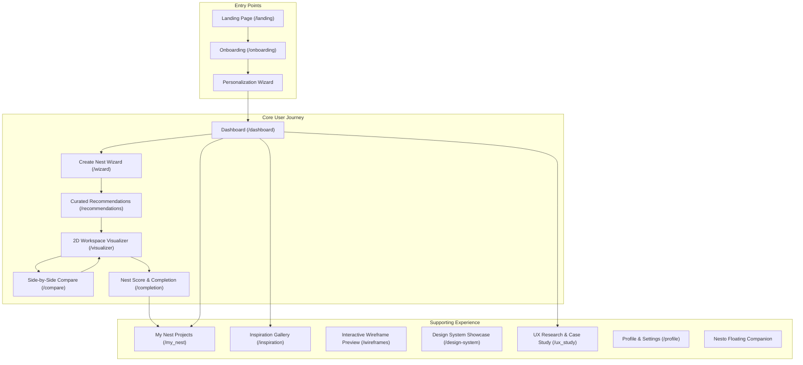

# Phase 1 — Product Architecture Document (NESTORA)

## 1. Executive Summary & Philosophy
**Product:** NESTORA  
**Tagline:** Weave Your Dream Home  
**Core Philosophy:** *Nestora should not give users more designs. It should help users confidently choose the right design.*

Nestora is a user-centered home interior and exterior design platform inspired by the Baya Weaver bird. The companion mascot, **Nesto**, guides non-professional homeowners through personalized choices using structured recommendations, explainable decision mechanics, and visual comparisons.

---

## 2. Information Architecture & Site Map

---

## 3. UX Principles & Heuristics Mapping

| UX Principle | Implementation in NESTORA Architectural Design |
|---|---|
| **Hick's Law** | Limit initial design recommendations to exactly 3–5 curated options. |
| **Fitts's Law** | Floating Nesto launcher, large primary sticky CTAs, minimum 44px touch targets. |
| **Jakob's Law** | Standard horizontal navigation bar, multi-step progress wizard pattern. |
| **Miller's Law** | Information chunked into clear steps (Space -> Goal -> Style -> Palette -> Budget). |
| **Tesler's Law** | Technical color reflectance (LRV) and finish chemistry hidden behind simple mood descriptions. |
| **Progressive Disclosure** | Advanced color controls (LRV values, custom RGB hex, texture finishes) hidden inside expanders. |
| **Recognition over Recall** | Color swatches shown visually alongside real-world names rather than raw codes. |
| **Gestalt Proximity** | Palette swatches grouped strictly near their target room element controls. |
| **Gestalt Similarity** | Uniform card structures for Recommendations, Inspirations, and Saved Nests. |
| **Goal-Gradient Effect** | Visual progress bar with percentage and step count during wizard flow. |
| **Zeigarnik Effect** | Unfinished Nest drafts stored automatically and prominently displayed on the Dashboard. |
| **Peak-End Rule** | Celebratory confetti, Nest Score breakdown, and summary download upon completion. |
| **Von Restorff Effect** | Primary action buttons highlighted in deep forest green with gold accenting. |
| **Aesthetic-Usability Effect** | Clean typography, warm color palette, and high-contrast readable elements. |
| **Visibility of System Status** | Instant 2D SVG color updating, loading spinners, state sync notifications. |
| **User Control & Freedom** | One-click Undo, Redo, Reset to Default, and Back buttons at every stage. |
| **Error Prevention** | Destructive actions (e.g. deleting a Nest) require modal confirmation. |

---

## 4. Logical Data Flow & State Architecture

Nestora operates with local deterministic state management persisted via `localStorage`:
1. `UserProfile`: Track user experience tier, saved preferences, and XP progression.
2. `UserPreferences`: Store selected space category (interior/exterior), room type, atmosphere goals, style, budget, and light conditions.
3. `ProjectNest`: Active and historical project drafts containing design versions and step history.
4. `CustomizedDesign`: Snapshot of wall color, accent color, ceiling color, trim color, lighting mood, finish, and Nest Score breakdown.

---

## 5. Screen Inventory & Routing Summary

1. `/landing` - Hero presentation & mascot introduction
2. `/onboarding` - 3-step value proposition walkthrough
3. `/dashboard` - Overview of active nests, quick start, and Nesto suggestions
4. `/wizard` - Multi-step room configuration journey
5. `/recommendations` - Curated design choices with "Why This Works" / "Why You Might Not Choose It"
6. `/visualizer` - Interactive 2D recolorable SVG room canvas with instant customization
7. `/compare` - Side-by-side comparison of 2 design versions with breakdown metrics
8. `/completion` - Final celebratory state with Nest Score, summary card, and export options
9. `/my_nest` - Project management dashboard (Active, Completed, Drafts)
10. `/inspiration` - Curated design gallery with instant "Apply to Nest" functionality
11. `/wireframes` - Phase 2 Low-Fidelity structural wireframe showcase
12. `/design-system` - Phase 3 Design Token & UI Component library showcase
13. `/ux_study` - Comprehensive UX rationale and research reference
14. `/profile` - Profile configuration, rank tracking, and data reset controls
