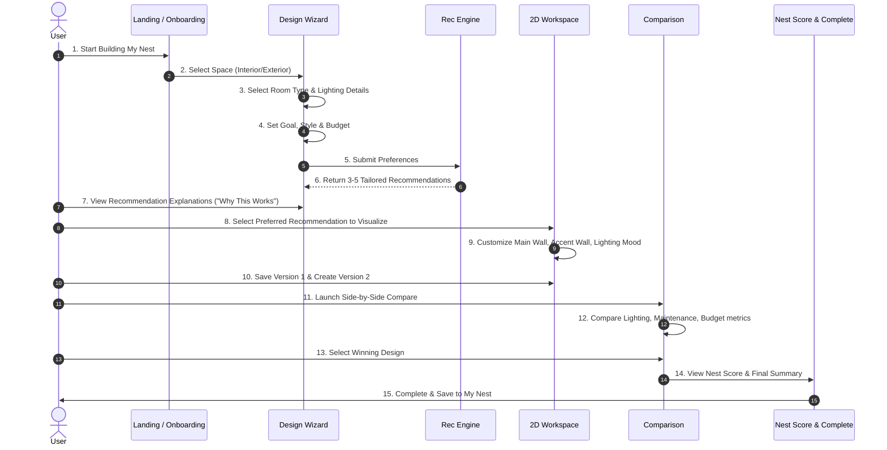

# Phase 1 — User Flows & Journey Specifications

## 1. Primary User Journey: End-to-End Design Selection

---

## 2. Secondary User Flows

### Flow 2.1 — Resuming an Unfinished Nest (Zeigarnik Effect)
1. User logs into Dashboard.
2. Dashboard highlights "In Progress Nest" card with step progress (e.g. "Step 3 of 4: Customizing").
3. User clicks **Resume Building**.
4. System loads saved state from `localStorage` directly into Visualizer Workspace without re-entry.

### Flow 2.2 — Inspiration to Applied Project
1. User visits `/inspiration`.
2. Filters by style (e.g. "Contemporary Indian" or "Minimalist").
3. User views full palette card and clicks **Apply to My Nest**.
4. System launches Wizard pre-filled with the inspiration style and palette colors.

### Flow 2.3 — "I'm Confused" Nesto Assistance
1. User feels overwhelmed during recommendation or visualization step.
2. User clicks Nesto companion or **I'm Confused** quick button.
3. Nesto asks: *"What matters most to you right now?"* (Options: Lower Cost, Better Appearance, Easy Maintenance, Family Preference).
4. System re-orders or highlights recommendations matching the user's single priority decision factor.

### Flow 2.4 — Family Voting & Feedback
1. User clicks **Share for Family Voting** on Visualizer page.
2. System generates shareable vote modal with current design preview.
3. Family members can select "Love it!", "Too dark", or "Change accent color".
4. Vote tally updates live in project metadata.
